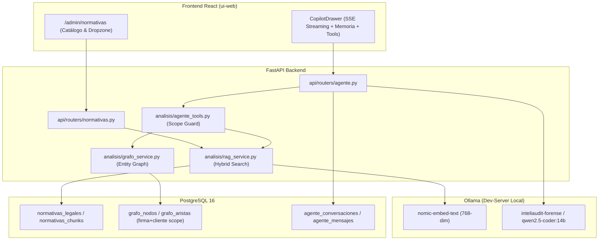

# Agente Forense con RAG Legal, Memoria en Grafo y Aislamiento Multi-Tenant - Implementation Plan

> **For agentic workers:** REQUIRED SUB-SKILL: Use superpowers:subagent-driven-development to implement this plan task-by-task. Steps use checkbox (`- [ ]`) syntax for tracking.

**Goal:** Construir e integrar el subsistema completo del Agente Auditor Forense para Inteliaudit, combinando RAG Legal dinámico con Ollama (`nomic-embed-text`), Memoria en Grafo relacional por cliente, ejecución de herramientas en vivo (*Tool Calling*) en Qwen 14B, y un panel administrativo web para ingesta de normativas DNIT.

**Architecture:** 
Arquitectura híbrida local en PostgreSQL y Ollama. Las normativas generales (Ley 6380, Dec 3107, RG 90) residen en un catálogo RAG global con chunking gramatical y embeddings de 768 dimensiones. Los datos económicos del cliente (facturas, proveedores, bancos) se modelan en un Grafo Relacional y Memoria de Conversación estrictamente aislados por `(firma_id, cliente_id, auditoria_id)`. El agente Qwen 14B resuelve consultas combinando búsqueda híbrida (FTS + vector) y llamadas a funciones SQL acotadas antes de responder por streaming SSE.

**Architecture Diagram:**



**Tech Stack:** Python 3.12, FastAPI, SQLAlchemy 2.0 Async, Alembic, PostgreSQL 16 (Full-Text Search + GIN), Ollama (`nomic-embed-text` + `qwen2.5-coder:14b`), React 18, TypeScript, Tailwind CSS, Lucide Icons.

**Spec:** [docs/superpowers/specs/2026-10-24-agente-forense-rag-memoria-design.md](file:///Users/gustaquevedo/Library/CloudStorage/OneDrive-Personal/Dev/Inteliaudit/docs/superpowers/specs/2026-10-24-agente-forense-rag-memoria-design.md)

## Global Constraints
- **Aislamiento Criptográfico y Relacional:** Toda lectura de grafo, comprobantes o memoria exige `firma_id` y `cliente_id` validados en el JWT del auditor. Prohibido omitir el scope.
- **Cero Costo en Inferencia/Embeddings:** Todo el procesamiento vectorial y de lenguaje natural corre en el dev-server local vía Ollama (`http://localhost:11434`).
- **Chunking Semántico Jurídico:** La segmentación legal no corta por longitud fija, sino por límites gramaticales (`Artículo`, `Capítulo`, `Inciso`).
- **Compatibilidad SQLite & PostgreSQL:** Los modelos y pruebas deben correr tanto en SQLite in-memory para `pytest` local como en PostgreSQL para producción.
- **Preservar Test Suite:** Las 154 pruebas existentes deben mantenerse pasando al 100%.

---

### Task 1: Modelos de Datos en SQLAlchemy y Migración Alembic

**Files:**
- Modify: `db/models.py`
- Create: `alembic/versions/20261024_agente_rag_grafo.py`
- Test: `tests/test_modelos_agente.py`

**Interfaces:**
- Produces: `NormativaLegal`, `NormativaChunk`, `GrafoNodo`, `GrafoArista`, `AgenteConversacion`, `AgenteMensaje` exportados desde `db.models`.

- [ ] **Step 1: Escribir el test fallido para los modelos**

```python
# tests/test_modelos_agente.py
import pytest
from sqlalchemy import select
from db.models import Firma, Cliente, Auditoria, NormativaLegal, NormativaChunk, GrafoNodo, GrafoArista, AgenteConversacion, AgenteMensaje

@pytest.mark.asyncio
async def test_crear_modelos_agente(db_session, firma_test, cliente_test, auditoria_test):
    # 1. Normativa y chunk
    norm = NormativaLegal(
        tipo="ley",
        numero="6380/2019",
        titulo="De Modernización y Simplificación del Sistema Tributario Nacional",
        organismo="DNIT"
    )
    db_session.add(norm)
    await db_session.flush()

    chunk = NormativaChunk(
        normativa_id=norm.id,
        jerarquia="Título I > Capítulo III > Art. 16",
        articulo="Art. 16",
        texto="No serán deducibles las sanciones por infracciones fiscales.",
        embedding=[0.1] * 768
    )
    db_session.add(chunk)

    # 2. Grafo del cliente
    nodo_cli = GrafoNodo(
        firma_id=firma_test.id,
        cliente_id=cliente_test.id,
        auditoria_id=auditoria_test.id,
        tipo="cliente",
        identificador=cliente_test.ruc,
        etiqueta=cliente_test.razon_social
    )
    nodo_prov = GrafoNodo(
        firma_id=firma_test.id,
        cliente_id=cliente_test.id,
        auditoria_id=auditoria_test.id,
        tipo="proveedor",
        identificador="80099887-1",
        etiqueta="PROVEEDOR FANTASMA SA"
    )
    db_session.add_all([nodo_cli, nodo_prov])
    await db_session.flush()

    arista = GrafoArista(
        firma_id=firma_test.id,
        cliente_id=cliente_test.id,
        auditoria_id=auditoria_test.id,
        nodo_origen_id=nodo_prov.id,
        nodo_destino_id=nodo_cli.id,
        relacion="PROVEEDOR_DE",
        metadatos_json={"total_facturado": 150000000}
    )
    db_session.add(arista)

    # 3. Conversación persistente
    conv = AgenteConversacion(
        firma_id=firma_test.id,
        auditoria_id=auditoria_test.id,
        titulo="Auditoría IRE Gastos No Deducibles"
    )
    db_session.add(conv)
    await db_session.flush()

    msg = AgenteMensaje(
        conversacion_id=conv.id,
        rol="user",
        contenido="¿Cuáles son los proveedores con RUC inactivo?"
    )
    db_session.add(msg)
    await db_session.commit()

    # Verificación
    res = await db_session.execute(select(NormativaLegal).where(NormativaLegal.id == norm.id))
    assert res.scalar_one().numero == "6380/2019"
```

- [ ] **Step 2: Ejecutar test para verificar que falla**
Run: `source .venv/bin/activate && pytest tests/test_modelos_agente.py -v`  
Expected: FAIL con `ImportError: cannot import name 'NormativaLegal' from 'db.models'`

- [ ] **Step 3: Agregar las definiciones en `db/models.py`**
Agregar las clases `NormativaLegal`, `NormativaChunk`, `GrafoNodo`, `GrafoArista`, `AgenteConversacion`, `AgenteMensaje` según la especificación técnica.

- [ ] **Step 4: Generar y verificar migración Alembic**
Run: `source .venv/bin/activate && alembic revision --autogenerate -m "add_agente_rag_and_grafo_tables"`  
Run: `pytest tests/test_modelos_agente.py -v`  
Expected: PASS

- [ ] **Step 5: Commit**
```bash
git add db/models.py alembic/versions/* tests/test_modelos_agente.py
git commit -m "feat(db): agregar tablas para normativas RAG, grafo de cliente y conversaciones del agente"
```

---

### Task 2: Parser Semántico Jurídico & Generación de Embeddings

**Files:**
- Create: `ingesta/normativas_parser.py`
- Create: `analisis/embeddings.py`
- Test: `tests/test_normativas_parser.py`

**Interfaces:**
- Produces: `parsear_texto_normativa(texto: str, titulo: str) -> list[ChunkNormativo]`
- Produces: `generar_embedding(texto: str) -> list[float]` (768 dimensiones vía Ollama `nomic-embed-text`)

- [ ] **Step 1: Escribir el test fallido para el parser semántico**

```python
# tests/test_normativas_parser.py
from ingesta.normativas_parser import parsear_texto_normativa, ChunkNormativo

def test_parsear_normativa_articulos():
    texto_ejemplo = """
    LEY N° 6380
    DE MODERNIZACIÓN Y SIMPLIFICACIÓN DEL SISTEMA TRIBUTARIO NACIONAL
    
    LIBRO I
    IMPUESTO A LA RENTA EMPRESARIAL (IRE)
    
    CAPÍTULO III
    RENTA NETA
    
    Artículo 16.- Gastos no deducibles.
    No serán deducibles en la determinación del IRE:
    1. Los intereses moratorios y multas.
    2. Los gastos personales del dueño o socios.
    
    Artículo 17.- Tasa del Impuesto.
    La tasa del IRE será del 10% (diez por ciento) sobre la renta neta imponible.
    """
    chunks = parsear_texto_normativa(texto_ejemplo, "Ley 6380/2019")
    assert len(chunks) == 2
    assert chunks[0].articulo == "Artículo 16"
    assert "Gastos no deducibles" in chunks[0].texto
    assert "LIBRO I" in chunks[0].jerarquia
    assert chunks[1].articulo == "Artículo 17"
```

- [ ] **Step 2: Ejecutar test para verificar que falla**
Run: `source .venv/bin/activate && pytest tests/test_normativas_parser.py -v`  
Expected: FAIL con `ModuleNotFoundError: No module named 'ingesta.normativas_parser'`

- [ ] **Step 3: Implementar `ingesta/normativas_parser.py` y `analisis/embeddings.py`**
Implementar regex para jerarquías y artículos legales paraguayos, y el conector a Ollama `http://localhost:11434/api/embeddings` con fallback silencioso en testing.

- [ ] **Step 4: Ejecutar test para verificar que pasa**
Run: `source .venv/bin/activate && pytest tests/test_normativas_parser.py -v`  
Expected: PASS

- [ ] **Step 5: Commit**
```bash
git add ingesta/normativas_parser.py analisis/embeddings.py tests/test_normativas_parser.py
git commit -m "feat(rag): implementar parser semantico de normativas legales y cliente de embeddings Ollama"
```

---

### Task 3: Servicio RAG Legal Híbrido

**Files:**
- Create: `analisis/rag_service.py`
- Test: `tests/test_rag_service.py`

**Interfaces:**
- Produces: `indexar_normativa(db, normativa, chunks) -> int`
- Produces: `buscar_normativas(db, query: str, limit: int = 5, firma_id: Optional[str] = None) -> list[ResultadoRAG]`

- [ ] **Step 1: Escribir el test fallido para el servicio RAG**

```python
# tests/test_rag_service.py
import pytest
from analisis.rag_service import indexar_normativa, buscar_normativas
from db.models import NormativaLegal

@pytest.mark.asyncio
async def test_indexar_y_buscar_rag(db_session):
    norm = NormativaLegal(tipo="ley", numero="6380/2019", titulo="Ley Tributaria")
    db_session.add(norm)
    await db_session.flush()

    articulos = [
        {"articulo": "Art. 16", "jerarquia": "IRE", "texto": "Gastos no deducibles: multas, sanciones y gastos personales."},
        {"articulo": "Art. 85", "jerarquia": "IVA", "texto": "Crédito fiscal admitido con comprobantes legales válidos."}
    ]
    await indexar_normativa(db_session, norm.id, articulos)
    
    # Búsqueda por coincidencia
    resultados = await buscar_normativas(db_session, query="sanciones fiscales deducibles", limit=2)
    assert len(resultados) >= 1
    assert "Art. 16" in resultados[0].articulo
```

- [ ] **Step 2: Ejecutar test para verificar que falla**
Run: `source .venv/bin/activate && pytest tests/test_rag_service.py -v`  
Expected: FAIL con `ModuleNotFoundError: No module named 'analisis.rag_service'`

- [ ] **Step 3: Implementar `analisis/rag_service.py`**
Implementar cálculo de similitud coseno vectorial combinado con búsqueda textual.

- [ ] **Step 4: Ejecutar test para verificar que pasa**
Run: `source .venv/bin/activate && pytest tests/test_rag_service.py -v`  
Expected: PASS

- [ ] **Step 5: Commit**
```bash
git add analisis/rag_service.py tests/test_rag_service.py
git commit -m "feat(rag): implementar servicio de busqueda hibrida y almacenamiento de normativas"
```

---

### Task 4: Grafo de Conocimiento Contable-Forense por Cliente

**Files:**
- Create: `analisis/grafo_service.py`
- Test: `tests/test_grafo_service.py`

**Interfaces:**
- Produces: `construir_grafo_auditoria(db, firma_id: str, cliente_id: str, auditoria_id: str) -> dict`
- Produces: `consultar_entidad_grafo(db, firma_id: str, cliente_id: str, auditoria_id: str, identificador: str) -> dict`

- [ ] **Step 1: Escribir el test fallido para el grafo del cliente**

```python
# tests/test_grafo_service.py
import pytest
from analisis.grafo_service import construir_grafo_auditoria, consultar_entidad_grafo

@pytest.mark.asyncio
async def test_construir_y_consultar_grafo(db_session, firma_test, cliente_test, auditoria_test, rg90_compras_fixture):
    # Generar grafo desde los comprobantes RG90 del cliente
    stats = await construir_grafo_auditoria(db_session, firma_test.id, cliente_test.id, auditoria_test.id)
    assert stats["nodos"] > 0
    assert stats["aristas"] > 0

    # Consultar relaciones del proveedor
    prov_ruc = rg90_compras_fixture[0].ruc_contraparte
    info = await consultar_entidad_grafo(db_session, firma_test.id, cliente_test.id, auditoria_test.id, prov_ruc)
    assert info is not None
    assert info["tipo"] == "proveedor"
    assert info["total_operaciones"] > 0
```

- [ ] **Step 2: Ejecutar test para verificar que falla**
Run: `source .venv/bin/activate && pytest tests/test_grafo_service.py -v`  
Expected: FAIL con `ModuleNotFoundError: No module named 'analisis.grafo_service'`

- [ ] **Step 3: Implementar `analisis/grafo_service.py`**
Construcción relacional de nodos y aristas a partir de `comprobantes_rg90`, `sifen_comprobantes` y `hallazgos` respetando aislamiento compuesto.

- [ ] **Step 4: Ejecutar test para verificar que pasa**
Run: `source .venv/bin/activate && pytest tests/test_grafo_service.py -v`  
Expected: PASS

- [ ] **Step 5: Commit**
```bash
git add analisis/grafo_service.py tests/test_grafo_service.py
git commit -m "feat(grafo): implementar generacion y consulta de grafo contable con aislamiento por cliente"
```

---

### Task 5: Tool Calling del Agente Forense y Endpoint Streaming

**Files:**
- Create: `analisis/agente_tools.py`
- Create: `api/routers/agente.py`
- Modify: `api/main.py`
- Test: `tests/test_agente_tools.py`

**Interfaces:**
- Produces: `ESQUEMA_HERRAMIENTAS` (JSON schema de las 5 herramientas)
- Produces: `ejecutar_herramienta(nombre, args, db, firma_id, cliente_id, auditoria_id)`
- Produces: `POST /api/auditorias/{id}/agente/chat` (SSE Streaming con bucle de tool calls)

- [ ] **Step 1: Escribir el test fallido para la ejecución de herramientas**

```python
# tests/test_agente_tools.py
import pytest
from analisis.agente_tools import ejecutar_herramienta

@pytest.mark.asyncio
async def test_ejecutar_herramienta_con_aislamiento(db_session, firma_test, cliente_test, auditoria_test):
    # Tool 1: recalcular contingencia
    res = await ejecutar_herramienta(
        "recalcular_contingencia_fiscal",
        {"monto": 10000000, "periodo": "2024-01", "reincidente": False},
        db_session, firma_test.id, cliente_test.id, auditoria_test.id
    )
    assert res["multa"] == 5000000
    assert res["total_contingencia"] > 10000000

    # Tool 2: búsqueda de comprobantes en scope
    comprobantes = await ejecutar_herramienta(
        "buscar_comprobantes_cliente",
        {"tipo": "compra"},
        db_session, firma_test.id, cliente_test.id, auditoria_test.id
    )
    assert isinstance(comprobantes, list)
```

- [ ] **Step 2: Ejecutar test para verificar que falla**
Run: `source .venv/bin/activate && pytest tests/test_agente_tools.py -v`  
Expected: FAIL con `ModuleNotFoundError: No module named 'analisis.agente_tools'`

- [ ] **Step 3: Implementar `analisis/agente_tools.py` y `api/routers/agente.py`**
Implementar las 5 tools con chequeo de scope `(firma_id, cliente_id)`, y orquestador SSE en `api/routers/agente.py` que interpreta llamadas JSON de Ollama y re-inyecta el resultado antes de generar la respuesta final.

- [ ] **Step 4: Ejecutar test para verificar que pasa**
Run: `source .venv/bin/activate && pytest tests/test_agente_tools.py -v`  
Expected: PASS

- [ ] **Step 5: Commit**
```bash
git add analisis/agente_tools.py api/routers/agente.py api/main.py tests/test_agente_tools.py
git commit -m "feat(agente): implementar herramientas operativas y endpoint streaming con tool calling"
```

---

### Task 6: Panel de Administración de Normativas en UI Web

**Files:**
- Create: `ui-web/src/pages/admin/NormativasAdmin.tsx`
- Modify: `ui-web/src/App.tsx`
- Modify: `ui-web/src/components/Sidebar.tsx`

**Interfaces:**
- Produces: Ruta `/admin/normativas` accesible desde la barra de navegación lateral.

- [ ] **Step 1: Escribir componente `NormativasAdmin.tsx`**
Diseño con catálogo de leyes, filtros por tipo (Ley, Decreto, RG), visor de cantidad de chunks y Dropzone para importar nuevas normas.

- [ ] **Step 2: Registrar ruta en `ui-web/src/App.tsx` y enlace en el Sidebar**
Agregar `<Route path="/admin/normativas" element={<NormativasAdmin />} />` y enlace con icono `BookOpen`.

- [ ] **Step 3: Compilar y validar el build de frontend**
Run: `cd ui-web && npm run build`  
Expected: Build exitoso sin errores de TypeScript.

- [ ] **Step 4: Commit**
```bash
git add ui-web/src/pages/admin/NormativasAdmin.tsx ui-web/src/App.tsx ui-web/src/components/Sidebar.tsx
git commit -m "feat(ui): agregar panel de administracion de normativas legales y dropzone RAG"
```

---

### Task 7: Copilot Drawer con Memoria Persistente y Visor de Tools

**Files:**
- Modify: `ui-web/src/components/CopilotDrawer.tsx`

**Interfaces:**
- Selector de conversaciones guardadas por auditoría.
- Chips visuales en tiempo real para indicar herramientas invocadas (`Consultó Art. 16 Ley 6380`, `Verificó RUC en Grafo`).
- Botón de 1-clic: "Convertir en Cédula de Trabajo NIA 230".

- [ ] **Step 1: Actualizar `CopilotDrawer.tsx`**
Incorporar carga de conversaciones persistentes, tags interactivos de tools invocadas y botón de exportación a Cédula.

- [ ] **Step 2: Compilar frontend y validar build**
Run: `cd ui-web && npm run build`  
Expected: Build exitoso en < 4s.

- [ ] **Step 3: Commit**
```bash
git add ui-web/src/components/CopilotDrawer.tsx
git commit -m "feat(ui): integrar memoria de conversaciones y visualizador de tools en CopilotDrawer"
```

---

### Task 8: Ingesta de Ley 6380 y RG 90 en Dev-Server y Validación End-to-End

**Files:**
- Create: `scripts/seed_normativas.py`
- Test: `tests/test_api.py`

**Interfaces:**
- Script de inicialización que descarga o parsea la Ley 6380/2019 y RG 90/2021 pre-indexando los chunks legales base.

- [ ] **Step 1: Escribir script `scripts/seed_normativas.py`**
Carga los textos normativos de referencia paraguayos en `normativas_legales` y `normativas_chunks` con embeddings de Ollama.

- [ ] **Step 2: Ejecutar test suite completo**
Run: `source .venv/bin/activate && pytest -v`  
Expected: 160+ tests pasando (154 anteriores + nuevos).

- [ ] **Step 3: Desplegar a dev-server (100.72.38.119)**
Run: `./scripts/deploy-devserver.sh`  
Run: `ssh root@100.72.38.119 "su - dev-server -c 'cd /home/dev-server/apps/inteliaudit && .venv/bin/python scripts/seed_normativas.py'"`

- [ ] **Step 4: Commit y push final**
```bash
git add scripts/seed_normativas.py
git commit -m "feat: sembrar normativas legales base y validar ejecucion integral del agente forense"
git push origin main
```
