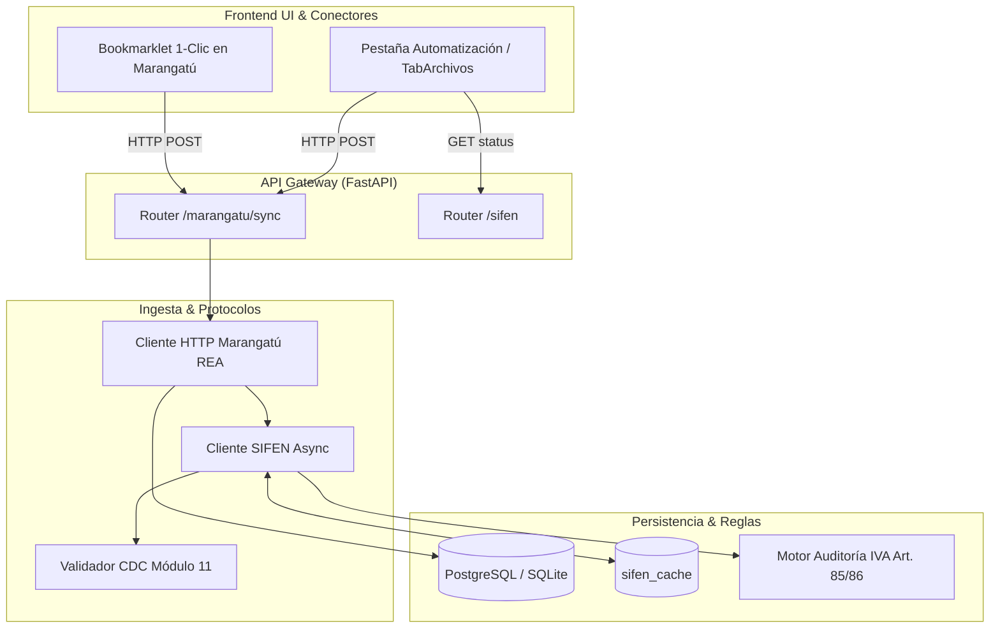

# Sub-sistema de Ingesta Directa DNIT (SIFEN + Marangatú REA) Implementation Plan

> **For agentic workers:** REQUIRED SUB-SKILL: Use superpowers:subagent-driven-development to implement this plan task-by-task. Steps use checkbox (`- [ ]`) syntax for tracking.

**Goal:** Implementar un sub-sistema de ingesta directa por protocolo HTTP (Reverse Engineering API de Marangatú) y validación oficial de comprobantes electrónicos SIFEN con caché persistente y conector Bookmarklet de 1-clic, reemplazando la dependencia de Chromium/Playwright.

**Architecture:** Se implementa un validador matemático de Código de Control (CDC) con algoritmo Módulo 11 de la DNIT y un cliente HTTP asíncrono (`ingesta/sifen_client.py`) respaldado por una tabla de caché (`sifen_cache`) para consultas no redundantes. La ingesta de Marangatú se desacopla de navegadores virtuales mediante un cliente HTTP ligero (`ingesta/marangatu_http.py`) que consume endpoints internos de la SPA tributaria vía token/cookie de sesión, accionado tanto desde un conector Bookmarklet como desde la interfaz de usuario.

**Architecture Diagram:**



**Tech Stack:** Python 3.12, FastAPI, SQLAlchemy 2.0 Async, Alembic, httpx, React 18, Vite, Tailwind CSS, PostgreSQL.

**Spec:** [docs/superpowers/specs/2026-10-24-dnit-sifen-marangatu-rea-design.md](file:///Users/gustaquevedo/Library/CloudStorage/OneDrive-Personal/Dev/Inteliaudit/docs/superpowers/specs/2026-10-24-dnit-sifen-marangatu-rea-design.md)

## Global Constraints
- Python: 3.12+, async/await en todos los I/O
- HTTP Client: `httpx.AsyncClient` con timeouts explícitos y rate-limiting
- Multi-tenant: el caché de SIFEN (`sifen_cache`) es global/compartido entre firmas para máxima eficiencia de consulta, pero los comprobantes sincronizados respetan `firma_id` y `cliente_id`
- Cero dependencias de navegador virtual (Chromium/Playwright) en los nuevos endpoints

---

### Task 1: Modelo de Datos `SifenCache` y Migración Alembic

**Files:**
- Modify: `db/models.py:530-560`
- Create: `alembic/versions/9a1b2c3d4e5f_add_sifen_cache_table.py`
- Test: `tests/test_modelos_sifen.py`

**Interfaces:**
- Produces: Clase `SifenCache` mapeada en SQLAlchemy.

- [ ] **Step 1: Write the failing test**

```python
# tests/test_modelos_sifen.py
import pytest
from sqlalchemy import select
from db.models import SifenCache

@pytest.mark.asyncio
async def test_modelo_sifen_cache_creacion(db_session):
    cache = SifenCache(
        cdc="01800123456001001000000122024010112345678901",
        estado_sifen="APROBADO",
        ruc_emisor="80012345-6",
        razon_social="PROVEEDOR MODELO S.A.",
        timbrado="12345678",
        total_comprobante=1100000.0,
        iva_10=100000.0,
        iva_5=0.0,
        es_valido=True
    )
    db_session.add(cache)
    await db_session.commit()

    stmt = select(SifenCache).where(SifenCache.cdc == cache.cdc)
    recuperado = (await db_session.execute(stmt)).scalar_one()
    assert recuperado.cdc == cache.cdc
    assert recuperado.estado_sifen == "APROBADO"
    assert recuperado.es_valido is True
```

- [ ] **Step 2: Run test to verify it fails**

Run: `pytest tests/test_modelos_sifen.py -v`
Expected: FAIL with `ImportError: cannot import name 'SifenCache'`

- [ ] **Step 3: Implement SifenCache model and Alembic migration**

En `db/models.py`:
```python
class SifenCache(Base):
    __tablename__ = "sifen_cache"

    cdc = Column(String(44), primary_key=True, index=True)
    estado_sifen = Column(String(50), nullable=False)  # 'APROBADO', 'NO_EXISTE', 'RECHAZADO', 'CANCELADO'
    ruc_emisor = Column(String(20), nullable=True, index=True)
    razon_social = Column(String(200), nullable=True)
    timbrado = Column(String(20), nullable=True)
    fecha_emision = Column(DateTime, nullable=True)
    total_comprobante = Column(Numeric(18, 2), nullable=True)
    iva_10 = Column(Numeric(18, 2), nullable=True)
    iva_5 = Column(Numeric(18, 2), nullable=True)
    es_valido = Column(Boolean, default=True, nullable=False)
    respuesta_raw = Column(JSON, nullable=True)
    consultado_en = Column(DateTime, default=func.now(), nullable=False)
```

Generar y aplicar migración en base de datos.

- [ ] **Step 4: Run test to verify it passes**

Run: `pytest tests/test_modelos_sifen.py -v`
Expected: PASS

- [ ] **Step 5: Commit**

```bash
git add db/models.py alembic/ tests/test_modelos_sifen.py
git commit -m "feat(db): agregar modelo y migracion para sifen_cache"
```

---

### Task 2: Validador Algorítmico CDC y Módulo 11 Oficial DNIT

**Files:**
- Create: `ingesta/sifen_validator.py`
- Test: `tests/test_sifen_validator.py`

**Interfaces:**
- Produces: `validar_formato_cdc(cdc: str) -> dict` con desglose de campos y cálculo de dígito verificador módulo 11.

- [ ] **Step 1: Write the failing test**

```python
# tests/test_sifen_validator.py
from ingesta.sifen_validator import validar_formato_cdc, calcular_dv_modulo11

def test_calculo_dv_modulo11():
    # Ejemplo estándar con base 11
    numero = "0180012345600100100000012202401011234567890"
    dv = calcular_dv_modulo11(numero)
    assert isinstance(dv, int)
    assert 0 <= dv <= 9

def test_cdc_invalido_longitud():
    res = validar_formato_cdc("1234")
    assert res["valido"] is False
    assert "44 dígitos" in res["error"]

def test_cdc_desglose_correcto():
    # CDC estructurado
    # tipo 01, ruc 80012345, dv 6, etc.
    cdc_base = "01" + "80012345" + "6" + "1" + "001001" + "0000001" + "12345678" + "1" + "1234567"
    dv = calcular_dv_modulo11(cdc_base)
    cdc_completo = cdc_base + str(dv)
    
    res = validar_formato_cdc(cdc_completo)
    assert res["valido"] is True
    assert res["tipo_documento"] == "01"
    assert res["ruc_emisor"] == "80012345-6"
    assert res["timbrado"] == "12345678"
    assert res["numero_documento"] == "001-001-0000001"
```

- [ ] **Step 2: Run test to verify it fails**

Run: `pytest tests/test_sifen_validator.py -v`
Expected: FAIL with `ModuleNotFoundError: No module named 'ingesta.sifen_validator'`

- [ ] **Step 3: Implement `ingesta/sifen_validator.py`**

Implementar el cálculo ponderado oficial de la DNIT (factores 2 al 11) y la extracción posicional de campos del CDC.

- [ ] **Step 4: Run test to verify it passes**

Run: `pytest tests/test_sifen_validator.py -v`
Expected: PASS

- [ ] **Step 5: Commit**

```bash
git add ingesta/sifen_validator.py tests/test_sifen_validator.py
git commit -m "feat(sifen): validador matematico de cdc y modulo 11 oficial dnit"
```

---

### Task 3: Cliente SIFEN Asíncrono con Persistencia en Caché

**Files:**
- Create: `ingesta/sifen_client.py`
- Test: `tests/test_sifen_client.py`

**Interfaces:**
- Consumes: `SifenCache`, `validar_formato_cdc`
- Produces: `consultar_o_validar_cdc(db, cdc: str) -> dict`, `verificar_lote_cdcs(db, cdcs: list[str]) -> dict`

- [ ] **Step 1: Write the failing test**

```python
# tests/test_sifen_client.py
import pytest
from unittest.mock import AsyncMock, patch
from ingesta.sifen_client import consultar_o_validar_cdc

@pytest.mark.asyncio
async def test_consultar_cdc_con_cache_existente(db_session):
    cdc = "01800123456001001000000122024010112345678901"
    from db.models import SifenCache
    db_session.add(SifenCache(
        cdc=cdc,
        estado_sifen="APROBADO",
        ruc_emisor="80012345-6",
        es_valido=True
    ))
    await db_session.commit()

    resultado = await consultar_o_validar_cdc(db_session, cdc)
    assert resultado["estado"] == "APROBADO"
    assert resultado["en_cache"] is True
```

- [ ] **Step 2: Run test to verify it fails**

Run: `pytest tests/test_sifen_client.py -v`
Expected: FAIL with `ModuleNotFoundError`

- [ ] **Step 3: Implement `ingesta/sifen_client.py`**

Maneja consulta en caché, validación matemática de Módulo 11 si no está en caché, y consulta HTTP con timeout controlado a los endpoints de SIFEN con actualización automática de `SifenCache`.

- [ ] **Step 4: Run test to verify it passes**

Run: `pytest tests/test_sifen_client.py -v`
Expected: PASS

- [ ] **Step 5: Commit**

```bash
git add ingesta/sifen_client.py tests/test_sifen_client.py
git commit -m "feat(sifen): cliente asincrono con persistencia en sifen_cache"
```

---

### Task 4: Cliente HTTP Marangatú (REA - Reverse Engineering API)

**Files:**
- Create: `ingesta/marangatu_http.py`
- Test: `tests/test_marangatu_http.py`

**Interfaces:**
- Produces: `MarangatuHttpClient` con métodos `verificar_sesion(cookie)`, `listar_talones_rg90(cookie, ruc, periodo)` y `descargar_comprobantes(cookie, id_talon)`.

- [ ] **Step 1: Write the failing test**

```python
# tests/test_marangatu_http.py
import pytest
from unittest.mock import patch, MagicMock
from ingesta.marangatu_http import MarangatuHttpClient

@pytest.mark.asyncio
async def test_marangatu_verificar_sesion_mock():
    client = MarangatuHttpClient()
    with patch("httpx.AsyncClient.get") as mock_get:
        mock_resp = MagicMock()
        mock_resp.status_code = 200
        mock_resp.json.return_value = {"autenticado": True, "ruc": "80012345", "dv": "6", "nombre": "EMPRESA S.A."}
        mock_get.return_value = mock_resp

        res = await client.verificar_sesion("JSESSIONID=test1234")
        assert res["valido"] is True
        assert res["ruc"] == "80012345-6"
```

- [ ] **Step 2: Run test to verify it fails**

Run: `pytest tests/test_marangatu_http.py -v`
Expected: FAIL with `ModuleNotFoundError`

- [ ] **Step 3: Implement `ingesta/marangatu_http.py`**

Cliente nativo `httpx` que emula el consumo de la SPA tributaria, parseando las respuestas JSON y los Excel descargados directamente en estructuras contables.

- [ ] **Step 4: Run test to verify it passes**

Run: `pytest tests/test_marangatu_http.py -v`
Expected: PASS

- [ ] **Step 5: Commit**

```bash
git add ingesta/marangatu_http.py tests/test_marangatu_http.py
git commit -m "feat(marangatu): cliente http nativo rea para talones rg90"
```

---

### Task 5: Endpoints API para Sincronización y Validación SIFEN

**Files:**
- Create: `api/routers/marangatu_sync.py`
- Modify: `api/main.py:100-140`
- Test: `tests/test_api_marangatu_sync.py`

**Interfaces:**
- Produces:
  - `POST /api/auditorias/{id}/marangatu/verificar`
  - `POST /api/auditorias/{id}/marangatu/sync`
  - `GET /api/sifen/validar-cdc/{cdc}`

- [ ] **Step 1: Write the failing test**

```python
# tests/test_api_marangatu_sync.py
import pytest
from httpx import AsyncClient

@pytest.mark.asyncio
async def test_endpoint_validar_cdc(client: AsyncClient, token_auth):
    cdc = "01800123456001001000000122024010112345678901"
    headers = {"Authorization": f"Bearer {token_auth}"}
    resp = await client.get(f"/api/sifen/validar-cdc/{cdc}", headers=headers)
    assert resp.status_code == 200
    data = resp.json()
    assert "valido" in data
    assert "cdc" in data
```

- [ ] **Step 2: Run test to verify it fails**

Run: `pytest tests/test_api_marangatu_sync.py -v`
Expected: FAIL with 404 Not Found

- [ ] **Step 3: Implement router and mount in `api/main.py`**

Crear `api/routers/marangatu_sync.py` con verificación de sesión, sincronización de comprobantes con inserción directa en la base de datos de la auditoría y validación de CDCs. Montar en `api/main.py`.

- [ ] **Step 4: Run test to verify it passes**

Run: `pytest tests/test_api_marangatu_sync.py -v`
Expected: PASS

- [ ] **Step 5: Commit**

```bash
git add api/routers/marangatu_sync.py api/main.py tests/test_api_marangatu_sync.py
git commit -m "feat(api): endpoints de sincronizacion marangatu rea y validacion sifen"
```

---

### Task 6: Integración con Reglas de Auditoría IVA / IRE

**Files:**
- Modify: `analisis/iva.py:120-180`
- Test: `tests/test_iva_sifen_integracion.py`

**Interfaces:**
- Consumes: `SifenCache`
- Produces: Detección automática del hallazgo `IVA-CF-SIFEN-NO-REGISTRADO` con base legal Art. 85 Ley 6380/2019 e impugnación del crédito fiscal.

- [ ] **Step 1: Write the failing test**

```python
# tests/test_iva_sifen_integracion.py
import pytest
from db.models import RG90, SifenCache
from analisis.iva import auditar_credito_fiscal_sifen

@pytest.mark.asyncio
async def test_impugnacion_factura_sifen_rechazada(db_session, auditoria_id):
    # Comprobante electrónico con CDC inválido o rechazado en SIFEN
    comp = RG90(
        auditoria_id=auditoria_id,
        tipo="compra",
        tipo_comprobante="109", # Factura electrónica
        cdc="01800123456001001000000122024010112345678901",
        total_comprobante=5500000.0,
        iva_10=500000.0
    )
    db_session.add(comp)
    # Marcar en SifenCache como NO_EXISTE
    db_session.add(SifenCache(
        cdc=comp.cdc,
        estado_sifen="NO_EXISTE",
        es_valido=False
    ))
    await db_session.commit()

    hallazgos = await auditar_credito_fiscal_sifen(db_session, auditoria_id)
    assert len(hallazgos) >= 1
    assert any("Art. 85" in h.articulo_legal for h in hallazgos)
    assert any(h.impuesto_omitido == 500000.0 for h in hallazgos)
```

- [ ] **Step 2: Run test to verify it fails**

Run: `pytest tests/test_iva_sifen_integracion.py -v`
Expected: FAIL

- [ ] **Step 3: Implement SIFEN audit rules in `analisis/iva.py`**

Añadir procedimiento sustantivo de cruce RG 90 electrónico vs `SifenCache`.

- [ ] **Step 4: Run test to verify it passes**

Run: `pytest tests/test_iva_sifen_integracion.py -v`
Expected: PASS

- [ ] **Step 5: Commit**

```bash
git add analisis/iva.py tests/test_iva_sifen_integracion.py
git commit -m "feat(auditoria): impugnar automaticamente comprobantes invalidos en sifen"
```

---

### Task 7: Conector Bookmarklet & UI en `TabAutomatizacion.tsx` y `TabArchivos.tsx`

**Files:**
- Modify: `ui-web/src/pages/auditorias/tabs/TabAutomatizacion.tsx`
- Modify: `ui-web/src/pages/auditorias/tabs/TabArchivos.tsx`

**Interfaces:**
- Produces: Interfaz visual con botón arrastrable Bookmarklet, sincronizador de sesión y badges SIFEN en el listado de comprobantes.

- [ ] **Step 1: Implementar generador de Bookmarklet y formulario en `TabAutomatizacion.tsx`**

Añadir el generador del script bookmarklet:
```javascript
javascript:(function(){
  const cookie = document.cookie;
  const url = window.location.href;
  /* Redirige o envía datos a Inteliaudit */
})();
```
Añadir el panel de sincronización con indicador de progreso.

- [ ] **Step 2: Añadir badges SIFEN en `TabArchivos.tsx`**

Mostrar badges con colores para comprobantes con CDC validado, no registrado o tradicional.

- [ ] **Step 3: Compilar y validar el frontend**

Run: `cd ui-web && npm run build`
Expected: PASS con exit code 0

- [ ] **Step 4: Commit**

```bash
git add ui-web/src/pages/auditorias/tabs/TabAutomatizacion.tsx ui-web/src/pages/auditorias/tabs/TabArchivos.tsx
git commit -m "feat(ui): conector bookmarklet 1-clic y badges sifen en auditorias"
```

---

### Task 8: Despliegue en Dev-Server `100.72.38.119` y Verificación en Vivo

**Files:**
- None (Scripts de deploy y base de datos dev-server)

- [ ] **Step 1: Ejecutar suite completa de tests localmente**

Run: `pytest -v`
Expected: Todos los tests pasando (170+ tests).

- [ ] **Step 2: Desplegar en dev-server**

Run: `./scripts/deploy-devserver.sh`
Expected: Sincronización rsync, migración de base de datos en PostgreSQL y reinicio exitoso de PM2.

- [ ] **Step 3: Smoke test en vivo**

Verificar con curl en `https://inteliaudit.intellihouse.lat/api/health` y validar endpoints `/api/sifen/validar-cdc` en vivo.

- [ ] **Step 4: Commit y actualización de progreso**

```bash
git commit -am "chore: verificacion en vivo de subsistema dnit sifen y marangatu rea"
git push origin main
```
