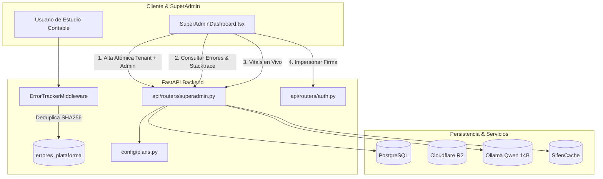

# SaaS SuperAdmin Platform Console Implementation Plan

> **For agentic workers:** REQUIRED SUB-SKILL: Use superpowers:subagent-driven-development to implement this plan task-by-task. Steps use checkbox (`- [ ]`) syntax for tracking.

**Goal:** Construir una consola de operaciones y plataforma SuperAdmin de clase mundial: alta atómica de tenants con contraseña temporal para primer login, control estricto de planes y features según la landing page, monitor de errores "Sentry-Lite" nativo con deduplicación y reporte para agente AI, consola de vitals en tiempo real e impersonación de firmas.

**Architecture:** Se extiende el modelo relacional con `ErrorPlataforma`, flags en `Firma` y `Usuario`, y se añade un middleware ASGI que intercepta excepciones no controladas deduplicándolas por hash SHA-256 (`fingerprint`). Los endpoints de SuperAdmin permiten crear tenants atómicamente con credenciales temporales, forzar límites de planes y emitir tokens de impersonación. La UI en React expone 4 pestañas interactivas de gestión y monitoreo.

**Architecture Diagram:**



**Tech Stack:** FastAPI, SQLAlchemy 2.0 Async, Alembic, PostgreSQL, Pydantic v2, React 18, TypeScript, Tailwind CSS, Lucide Icons, Ollama.

**Spec:** [docs/superpowers/specs/2026-10-24-saas-superadmin-platform-console-design.md](file:///Users/gustaquevedo/Library/CloudStorage/OneDrive-Personal/Dev/Inteliaudit/docs/superpowers/specs/2026-10-24-saas-superadmin-platform-console-design.md)

## Global Constraints

- **Multi-tenant aislado:** Cada tenant tiene sus propios datos protegidos; el SuperAdmin tiene observabilidad global pero las sesiones impersonadas operan con scope explícito.
- **Deduplicación determinista:** El fingerprint de errores se calcula con `hashlib.sha256(f"{tipo_error}:{ultimo_frame_file}:{ultimo_frame_line}".encode()).hexdigest()`.
- **Zero data loss & fail-safe:** El middleware de errores nunca debe interrumpir ni crashear el servidor si falla la persistencia del log.
- **TDD:** Cada endpoint y componente backend debe tener pruebas unitarias e integración en `tests/`.

---

### Task 1: Modelo de Datos en SQLAlchemy y Migración Alembic

**Files:**
- Modify: `db/models.py:50-90, 400-470`
- Create: `alembic/versions/*_add_error_plataforma_and_superadmin_fields.py`
- Test: `tests/test_modelos_superadmin.py`

**Interfaces:**
- Consumes: SQLAlchemy Base
- Produces: `ErrorPlataforma` model, `Usuario.debe_cambiar_password`, `Firma.features_override_json`

- [ ] **Step 1: Write the failing test**

```python
# tests/test_modelos_superadmin.py
import pytest
from sqlalchemy import select
from db.models import Firma, Usuario, ErrorPlataforma

@pytest.mark.asyncio
async def test_modelo_error_plataforma_y_campos_superadmin(db_session, firma: Firma):
    # Verificar campos en Usuario y Firma
    user = Usuario(
        firma_id=firma.id,
        email="nuevo_admin@estudio.com.py",
        nombre="Admin Tenant",
        password_hash="hash_dummy",
        rol="admin",
        debe_cambiar_password=True,
    )
    db_session.add(user)
    firma.features_override_json = '{"tiene_ia": true, "max_clientes": 20}'
    
    # Verificar ErrorPlataforma
    err = ErrorPlataforma(
        fingerprint="test_fp_1234567890abcdef",
        tipo_error="ZeroDivisionError",
        mensaje="division by zero",
        path="/api/test/fail",
        metodo="POST",
        status_code=500,
        stacktrace="Traceback (most recent call last):\n  File ...",
        firma_id=firma.id,
        usuario_email=user.email,
        ocurrencias=1,
    )
    db_session.add(err)
    await db_session.commit()

    saved_err = (await db_session.execute(select(ErrorPlataforma).where(ErrorPlataforma.fingerprint == "test_fp_1234567890abcdef"))).scalar_one()
    assert saved_err.tipo_error == "ZeroDivisionError"
    assert saved_err.ocurrencias == 1
    assert saved_err.resuelto is False
```

- [ ] **Step 2: Run test to verify it fails**

Run: `.venv/bin/pytest tests/test_modelos_superadmin.py -v`
Expected: FAIL with `ImportError: cannot import name 'ErrorPlataforma' from 'db.models'`

- [ ] **Step 3: Implement models in `db/models.py` and generate migration**

Agregar `debe_cambiar_password` a `Usuario`, `features_override_json` a `Firma`, y crear la clase `ErrorPlataforma`. Generar migración Alembic con `.venv/bin/alembic revision --autogenerate -m "add_error_plataforma_and_superadmin_fields"`.

- [ ] **Step 4: Run test to verify it passes**

Run: `.venv/bin/pytest tests/test_modelos_superadmin.py -v`
Expected: PASS

- [ ] **Step 5: Commit**

```bash
git add db/models.py alembic/versions/* tests/test_modelos_superadmin.py
git commit -m "feat(db): modelos para error tracker sentry-lite y superadmin"
```

---

### Task 2: Middleware ASGI de Captura y Deduplicación de Errores ("Sentry-Lite")

**Files:**
- Create: `api/middleware/error_tracker.py`
- Modify: `api/main.py`
- Test: `tests/test_error_tracker_middleware.py`

**Interfaces:**
- Consumes: `ErrorPlataforma`, `async_session_factory`
- Produces: `ErrorTrackerMiddleware` para interceptar 500s y registrar en base de datos.

- [ ] **Step 1: Write the failing test**

```python
# tests/test_error_tracker_middleware.py
import pytest
from httpx import AsyncClient, ASGITransport
from sqlalchemy import select
from db.models import ErrorPlataforma
from api.main import app

@pytest.mark.asyncio
async def test_middleware_captura_excepcion_y_deduplica(db_session):
    # Ruta de test que arroja excepción deliberada
    @app.get("/api/test-trigger-error-500", include_in_schema=False)
    async def trigger_error():
        raise RuntimeError("Fallo forzado de prueba para Sentry-Lite")

    transport = ASGITransport(app=app)
    async with AsyncClient(transport=transport, base_url="http://test") as ac:
        resp = await ac.get("/api/test-trigger-error-500")
        assert resp.status_code == 500
        data = resp.json()
        assert "error_ref" in data

        # Segunda llamada con el mismo error debe deduplicar
        resp2 = await ac.get("/api/test-trigger-error-500")
        assert resp2.status_code == 500

    # Verificar en DB que se registró y contó ocurrencias
    errs = (await db_session.execute(select(ErrorPlataforma).where(ErrorPlataforma.tipo_error == "RuntimeError"))).scalars().all()
    assert len(errs) == 1
    assert errs[0].ocurrencias >= 2
```

- [ ] **Step 2: Run test to verify it fails**

Run: `.venv/bin/pytest tests/test_error_tracker_middleware.py -v`
Expected: FAIL with `ModuleNotFoundError: No module named 'api.middleware.error_tracker'`

- [ ] **Step 3: Implement `api/middleware/error_tracker.py` and register in `api/main.py`**

Crear el middleware que intercepta excepciones en el ciclo de vida ASGI, genera el fingerprint SHA-256 de forma determinista, deduplica registros contra `ErrorPlataforma` y retorna un JSON amigable con `error_ref`.

- [ ] **Step 4: Run test to verify it passes**

Run: `.venv/bin/pytest tests/test_error_tracker_middleware.py -v`
Expected: PASS

- [ ] **Step 5: Commit**

```bash
git add api/middleware/error_tracker.py api/main.py tests/test_error_tracker_middleware.py
git commit -m "feat(telemetry): middleware sentry-lite con deduplicacion de errores"
```

---

### Task 3: Endpoints SuperAdmin para Creación Atómica de Tenants y Usuarios

**Files:**
- Modify: `api/routers/superadmin.py`
- Test: `tests/test_superadmin_creacion_tenants.py`

**Interfaces:**
- Consumes: `Firma`, `Usuario`, `_hash`, `PLANES`
- Produces: `POST /api/superadmin/firmas`, `POST /api/superadmin/usuarios`

- [ ] **Step 1: Write the failing test**

```python
# tests/test_superadmin_creacion_tenants.py
import pytest
from httpx import AsyncClient, ASGITransport
from api.main import app
from db.models import Firma, Usuario

@pytest.mark.asyncio
async def test_crear_firma_atomica_con_admin_y_password_temporal(db_session, usuario_admin: Usuario):
    usuario_admin.rol = "super_admin"
    await db_session.commit()

    from api.routers.auth import _crear_token
    token = _crear_token({"sub": usuario_admin.id, "firma_id": usuario_admin.firma_id, "rol": "super_admin"})

    transport = ASGITransport(app=app)
    async with AsyncClient(transport=transport, base_url="http://test") as ac:
        headers = {"Authorization": f"Bearer {token}"}
        payload = {
            "nombre": "Estudio Contable Benitez & Asoc",
            "ruc": "80088888-2",
            "email_contacto": "contacto@benitez.com.py",
            "plan": "pro",
            "trial_dias": 14,
            "admin_nombre": "Carlos Benitez",
            "admin_email": "carlos@benitez.com.py"
        }
        resp = await ac.post("/api/superadmin/firmas", json=payload, headers=headers)
        assert resp.status_code == 201
        data = resp.json()
        assert data["firma"]["nombre"] == payload["nombre"]
        assert data["usuario_admin"]["email"] == payload["admin_email"]
        assert "password_temporal" in data["usuario_admin"]
        assert len(data["usuario_admin"]["password_temporal"]) >= 10
        assert data["usuario_admin"]["debe_cambiar_password"] is True
```

- [ ] **Step 2: Run test to verify it fails**

Run: `.venv/bin/pytest tests/test_superadmin_creacion_tenants.py -v`
Expected: FAIL with 404 or 405 Method Not Allowed

- [ ] **Step 3: Implement atomic tenant creation in `api/routers/superadmin.py`**

Añadir schemas `FirmaCreateBody`, `UsuarioCreateBodySuperAdmin`, generar contraseña segura aleatoria (`secrets.token_urlsafe(9)`), crear transacción atómica de `Firma` + `Usuario` y retornar credenciales en claro solo en el payload de creación.

- [ ] **Step 4: Run test to verify it passes**

Run: `.venv/bin/pytest tests/test_superadmin_creacion_tenants.py -v`
Expected: PASS

- [ ] **Step 5: Commit**

```bash
git add api/routers/superadmin.py tests/test_superadmin_creacion_tenants.py
git commit -m "feat(superadmin): creacion atomica de firmas y usuarios con password temporal"
```

---

### Task 4: Endpoints de Impersonación, Métricas SaaS, Sentry-Lite y Vitals

**Files:**
- Modify: `api/routers/superadmin.py`
- Test: `tests/test_superadmin_vitals_y_errores.py`

**Interfaces:**
- Consumes: `ErrorPlataforma`, `psutil`, `httpx` (Ollama tags check)
- Produces: `POST /firmas/{id}/impersonate`, `GET /vitals`, `GET /errores`, `POST /errores/{id}/resolver`, `GET /stats`

- [ ] **Step 1: Write the failing test**

```python
# tests/test_superadmin_vitals_y_errores.py
import pytest
from httpx import AsyncClient, ASGITransport
from api.main import app
from db.models import Usuario, ErrorPlataforma

@pytest.mark.asyncio
async def test_superadmin_vitals_y_listar_errores(db_session, usuario_admin: Usuario):
    usuario_admin.rol = "super_admin"
    await db_session.commit()

    from api.routers.auth import _crear_token
    token = _crear_token({"sub": usuario_admin.id, "firma_id": usuario_admin.firma_id, "rol": "super_admin"})

    transport = ASGITransport(app=app)
    async with AsyncClient(transport=transport, base_url="http://test") as ac:
        headers = {"Authorization": f"Bearer {token}"}
        
        # Test Vitals
        resp_vitals = await ac.get("/api/superadmin/vitals", headers=headers)
        assert resp_vitals.status_code == 200
        vitals = resp_vitals.json()
        assert "database" in vitals
        assert "sifen_cache_items" in vitals

        # Test Error List
        resp_err = await ac.get("/api/superadmin/errores", headers=headers)
        assert resp_err.status_code == 200
        assert isinstance(resp_err.json(), list)
```

- [ ] **Step 2: Run test to verify it fails**

Run: `.venv/bin/pytest tests/test_superadmin_vitals_y_errores.py -v`
Expected: FAIL with 404 Not Found

- [ ] **Step 3: Implement endpoints in `api/routers/superadmin.py`**

Implementar:
- `POST /firmas/{id}/impersonate`: emite JWT con `impersonating_firma_id` y rol del admin de esa firma.
- `GET /vitals`: testea DB latency, cuenta `sifen_cache`, comprueba Ollama `/api/tags` en localhost:11434 y memoria del sistema.
- `GET /errores` y `POST /errores/{id}/resolver`: gestión de incidentes con template markdown para copiar al portapapeles.
- `GET /stats`: cálculo de MRR estimado en Gs., conteo de firmas por plan y usuarios totales.

- [ ] **Step 4: Run test to verify it passes**

Run: `.venv/bin/pytest tests/test_superadmin_vitals_y_errores.py -v`
Expected: PASS

- [ ] **Step 5: Commit**

```bash
git add api/routers/superadmin.py tests/test_superadmin_vitals_y_errores.py
git commit -m "feat(superadmin): vitals en vivo, lista de errores sentry-lite e impersonacion"
```

---

### Task 5: Control Estricto de Límites de Planes y Feature Flags de la Landing

**Files:**
- Modify: `api/routers/auth.py:250-280`
- Modify: `api/routers/copilot.py`
- Modify: `config/plans.py`
- Test: `tests/test_plan_limits_enforcement.py`

**Interfaces:**
- Consumes: `get_plan`, `can_add_usuario`, `can_use_ia`
- Produces: Control de límites consistente en creación de usuarios e invocación de IA forense.

- [ ] **Step 1: Write the failing test**

```python
# tests/test_plan_limits_enforcement.py
import pytest
from httpx import AsyncClient, ASGITransport
from api.main import app
from db.models import Firma, Usuario

@pytest.mark.asyncio
async def test_starter_plan_bloquea_exceso_usuarios(db_session, firma: Firma, usuario_admin: Usuario):
    firma.plan = "starter"  # Máximo 3 usuarios
    await db_session.commit()

    from api.routers.auth import _crear_token
    token = _crear_token({"sub": usuario_admin.id, "firma_id": firma.id, "rol": "admin"})

    # Agregar 2 usuarios más (total 3)
    u1 = Usuario(firma_id=firma.id, email="u1@test.com", nombre="U1", password_hash="h", rol="auditor")
    u2 = Usuario(firma_id=firma.id, email="u2@test.com", nombre="U2", password_hash="h", rol="auditor")
    db_session.add_all([u1, u2])
    await db_session.commit()

    # Intentar crear el 4to usuario debe arrojar 403
    transport = ASGITransport(app=app)
    async with AsyncClient(transport=transport, base_url="http://test") as ac:
        headers = {"Authorization": f"Bearer {token}"}
        resp = await ac.post("/api/auth/usuarios", json={
            "email": "u4@test.com",
            "nombre": "U4",
            "password": "Password123!",
            "rol": "auditor"
        }, headers=headers)
        assert resp.status_code == 403
        assert "permite hasta 3 usuarios" in resp.json()["detail"]
```

- [ ] **Step 2: Run test to verify it fails**

Run: `.venv/bin/pytest tests/test_plan_limits_enforcement.py -v`
Expected: FAIL with status code 201 instead of 403

- [ ] **Step 3: Implement validation in `api/routers/auth.py`**

Verificar conteo de usuarios existentes contra `plan_cfg.max_usuarios` (considerando `features_override_json` si existe) antes de insertar un nuevo usuario.

- [ ] **Step 4: Run test to verify it passes**

Run: `.venv/bin/pytest tests/test_plan_limits_enforcement.py -v`
Expected: PASS

- [ ] **Step 5: Commit**

```bash
git add api/routers/auth.py config/plans.py tests/test_plan_limits_enforcement.py
git commit -m "feat(planes): control estricto de limites de usuarios segun landing"
```

---

### Task 6: Rediseño de la UI SuperAdminDashboard (4 Pestañas Operativas)

**Files:**
- Modify: `ui-web/src/pages/admin/SuperAdminDashboard.tsx`
- Modify: `ui-web/src/context/AuthContext.tsx`
- Modify: `ui-web/src/api/types.ts`

**Interfaces:**
- Produces: Interfaz visual de SuperAdmin con 4 pestañas: Firmas/Tenants con Modal de Alta Atómica y tarjeta de credenciales, Usuarios Globales, Sentry-Lite con Visor de Stacktrace y Copiar para Agente, y System Vitals con status en tiempo real.

- [ ] **Step 1: Implementar componentes y modales en `SuperAdminDashboard.tsx`**

1. Pestaña 1: **Firmas (Tenants)**:
   - Tarjetas KPI: MRR Gs., Tenants Activos, En Trial, Clientes Totales.
   - Modal "+ Nueva Firma": Formulario atómico con nombre, RUC, plan selector, días trial y datos de admin fundador.
   - Modal revelador de credenciales con botón "Copiar Acceso".
   - Botón "Impersonar" que guarda token y recarga aplicación en contexto de la firma.
2. Pestaña 2: **Usuarios Globales**:
   - Listado con selector de firma, badge de rol, estado y reseteo rápido de contraseña.
3. Pestaña 3: **Sentry-Lite (Errores de Plataforma)**:
   - Tabla interactiva de incidentes con severidad, ruta, método, contador de ocurrencias y último impacto.
   - Drawer o Modal de Stacktrace con sintaxis monoespaciada y botón **`[📋 Copiar Reporte para Agente AI]`**.
   - Botón `[✓ Marcar Resuelto]`.
4. Pestaña 4: **Salud del Sistema (Vitals)**:
   - Tarjetas de estado en vivo para PostgreSQL, Cloudflare R2, Ollama Qwen 14B y SIFEN Cache.

- [ ] **Step 2: Compilar y validar el frontend**

Run: `cd ui-web && npm run build`
Expected: PASS con 0 errores TypeScript

- [ ] **Step 3: Commit**

```bash
git add ui-web/src/pages/admin/SuperAdminDashboard.tsx ui-web/src/context/AuthContext.tsx ui-web/src/api/types.ts
git commit -m "feat(ui): consola de operaciones superadmin con sentry-lite, vitals y alta atomica"
```

---

### Task 7: Verificación de la Suite de Pruebas y Despliegue en Dev-Server `100.72.38.119`

**Files:**
- Modify: `scripts/deploy-devserver.sh`

**Interfaces:**
- Produces: Despliegue en vivo en `https://inteliaudit.intellihouse.lat`, migración de base de datos en PostgreSQL y verificación de health check y consola.

- [ ] **Step 1: Ejecutar la suite completa de tests localmente**

Run: `.venv/bin/pytest -v`
Expected: ~190 tests en verde (100% PASS)

- [ ] **Step 2: Ejecutar el script de despliegue al dev-server**

Run: `./scripts/deploy-devserver.sh`
Expected: Migración PostgreSQL aplicada, sincronización de frontend compilado y reinicio PM2.

- [ ] **Step 3: Verificación en vivo**

Run: `curl -s https://inteliaudit.intellihouse.lat/api/health`
Expected: `{"status":"ok", ...}`

- [ ] **Step 4: Commit y actualización de ledger**

```bash
git add .superpowers/sdd/2026-10-24-saas-superadmin/progress.md
git commit -m "chore(deploy): despliegue de consola superadmin y sentry-lite en dev-server"
```
